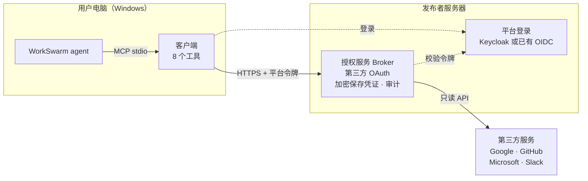

# WorkSwarm 统一授权连接器

让 WorkSwarm agent 以只读方式访问用户的 Gmail、Google Drive、Google Calendar、GitHub、Outlook 和 Slack。
用户不需要申请或填写任何 Client ID、Secret 或 token：发布者在服务器上统一配置第三方应用，
用户只需在浏览器里登录并同意授权。

版本 0.7.2 · 客户端仅支持 Windows · 所有操作只读

## 工作原理

- **客户端**：运行在用户电脑上，首次连接时由 WorkSwarm 自动下载安装，向 agent 提供 8 个工具。
- **授权服务（Broker）**：由发布者运行，负责第三方 OAuth，加密保存令牌，并代用户调用第三方 API。
- **平台登录**：确认用户身份，可以用附带的 Keycloak，也可以对接已有的 OIDC 系统。

第三方令牌只保存在授权服务上，客户端只保存用户自己的平台登录会话。

## 用户指南

前提：发布者已部署服务并上架连接器；Windows 上装有 Python 3.11 或更高版本
（推荐 python.org 的 3.12 安装包，自带 `py` 启动器）。

1. 在 WorkSwarm 连接器市场安装“第三方统一授权（云端托管）”，点 **连接**。
   首次连接会自动安装客户端，约需 20–60 秒，之后每次一两秒。
2. 新建会话，在输入框旁的扩展面板里勾选本连接器。没有勾选时 agent 看不到工具。
3. 直接提需求，例如“帮我连接 Gmail，然后看看最近一周的邮件”。
4. 浏览器会打开平台登录页，然后跳到服务商的官方授权页，同意即可。全程使用同一个浏览器，不要刷新页面。

每个服务只需授权一次。

### 支持的服务

| 服务 | 示例说法 | 可用操作 |
|---|---|---|
| Gmail | “看看我最近的邮件” | `gmail_search`、`gmail_read` |
| Google Drive | “列出我云端硬盘里的文件” | `drive_list` |
| Google Calendar | “列出我的日历” | `calendar_list` |
| GitHub | “列出我的 GitHub 仓库” | `github_profile`、`github_repos` |
| Microsoft（Outlook） | “看看我的 Outlook 邮件” | `microsoft_profile`、`outlook_list` |
| Slack | “查看我的 Slack 连接身份” | `slack_identity` |

### 管理连接

| 想做的事 | 对 agent 说 |
|---|---|
| 查看连接状态 | “看看我连接了哪些服务”。`authorization=authorized` 且 `validation=passed` 才算可用 |
| 重新登录平台 | “调用 auth_login 重新登录”。已有连接不受影响 |
| 连接同一服务的另一个账号 | “用新的连接 ID 再连接一个 Gmail 账号” |
| 断开连接 | “断开我的 GitHub 连接”。会删除服务器上的凭证，并尽量在服务商处撤销授权 |

### 常见问题

| 现象 | 处理 |
|---|---|
| 提示找不到 `py` | 安装 python.org 版 Python（含 `py` 启动器），重启 WorkSwarm |
| 首次连接失败 | 多半是无法访问 PyPI 或发布者服务器；查看 WorkSwarm 日志中以 `[workswarm-auth]` 开头的行 |
| agent 说找不到工具 | 当前会话没有勾选本连接器 |
| `workswarm_login_required` | 平台会话已失效，调用 `auth_login` 重新登录 |
| `cloud_service_unavailable` | 连不上发布者服务器，检查网络后重试 |
| `operation_denied_by_policy`、`operation_not_allowed` | 操作名不对，不是账号被禁止；改用错误信息里 `allowed_operations` 列出的操作 |
| `connection_link_expired_or_used` | 连接链接只能用一次，让 agent 重新发起连接 |
| `reauthorization_required` | 第三方授权已失效，让 agent 重新连接该服务 |

## 发布者指南

发布者负责部署授权服务并上架连接器，开发者负责维护代码。完整步骤见 **[发布指南](docs/PUBLISHING.md)**，概要如下：

1. 准备一台 Linux 主机（Docker、Compose v2）、授权服务域名和平台登录域名。
2. 生成部署配置。
3. 在 Google、GitHub、Microsoft、Slack 创建 OAuth 应用，把 Client ID 和 Secret 录入服务器。
4. 用 `docker compose` 启动服务。
5. 开通用户账号：管理员手动建号，或开启 Google、GitHub 登录自动开户。
6. 构建客户端包和连接器包，把客户端包放到服务器上。
7. 把连接器包上架到 WorkSwarm Hub。
8. 在干净的 Windows 上验收。

公开发布前，Google 等服务商要审核应用；作为企业产品，还可能需要 SOC 2、ISO 27001、等保等认证。
详见发布指南的“上线审核与认证”一节。

## 当前限制

- 客户端只支持 Windows。
- 服务端是单实例 SQLite，密钥以文件保存，未做高可用、KMS 或生产安全审查。
- 启动器下载客户端时不校验哈希，依赖版本未锁定。
- 仓库还没有 LICENSE 文件，使用前请向代码所有者确认授权。

## 文档

| 文档 | 内容 |
|---|---|
| [docs/PUBLISHING.md](docs/PUBLISHING.md) | 部署、第三方应用配置、上架、维护、排查、上线审核与认证 |
| [CLOUD.md](CLOUD.md) | 对接已有身份系统、无公网域名时的测试部署 |
| [VALIDATION.md](VALIDATION.md) | 已验证和尚未验证的范围 |

问题请在本仓库提 Issue，附上错误码和日志，发送前去掉令牌、密钥和用户信息。
安全问题请私下联系代码所有者，不要写在 Issue 里。
