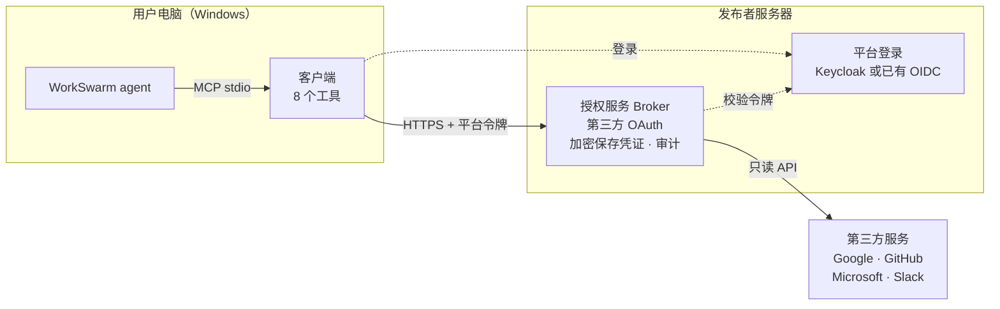

# WorkSwarm 统一授权 Connector v0.7.2

请求链路：**WorkSwarm → 云端授权服务 → 第三方 API**。
发布者在服务器配置第三方应用，普通用户不填写第三方 Client ID、Secret 或 token。
支持 Gmail、Google Drive、Google Calendar、GitHub、Microsoft（Outlook）、Slack，均为只读操作。

## 架构



用户只在浏览器里登录平台、在第三方页面同意授权，第三方回调到授权服务。
第三方令牌只保存在授权服务上，客户端只持有平台会话。

| 组件 | 职责 |
|---|---|
| 服务端 `app / manager / providers / vault / security` | 第三方 OAuth、凭证加密、刷新/撤销、账号隔离、API 验证；强制 OIDC，不接受静态 API Key |
| 客户端 `cloud / cloud_commands / cloud_mcp / session_store` | 平台 OIDC 登录、浏览器跳转、授权等待/取消和 API 转发；仅缓存自己的平台会话，不建立凭证数据库 |
| 发布工具 `tools/` | 生成部署配置，以及不含服务端代码和密钥的客户端包、连接器包 |

本文是主要操作指南。[CLOUD.md](CLOUD.md) 补充对接已有身份系统、无公网域名测试部署等细节；验证范围见 [VALIDATION.md](VALIDATION.md)。

### 术语

| 术语 | 含义 |
|---|---|
| 授权服务（Broker） | 发布者运行的服务端：处理第三方 OAuth，加密保存凭证，并代用户调用第三方 API |
| 平台登录（OIDC 身份系统） | 确认用户身份的登录系统，可以用已有系统，也可以部署附带的 Keycloak |
| Keycloak、realm | Keycloak 是开源登录系统；realm 是其中一组独立的用户和配置，本项目使用 `workswarm` |
| issuer | 身份系统的地址标识，令牌中的值必须和配置一致 |
| 客户端包（`.whl`） | 运行在用户电脑上的程序，放在授权服务上供下载 |
| 连接器包（market zip） | 上架到 Hub 的包，写有启动命令和授权服务地址，不含客户端程序 |

## 用户如何使用

以下步骤面向普通用户，前提是发布者已完成部署并上架连接器。用户只需在 Windows 上安装 Python 3.11 或更高版本
（推荐 python.org 的 3.12 安装包，自带 `py` 启动器），不需要第三方 Client ID、Secret 或 token。

### 首次使用

1. **安装连接器**：在 WorkSwarm 连接器市场找到“第三方统一授权（云端托管）”并安装。
2. **点“连接”**：首次连接会自动下载并安装客户端，约需 20–60 秒，看到 8 个工具即完成。之后每次连接只需一两秒。
3. **新建会话**：在输入框旁的扩展面板中勾选本连接器。WorkSwarm 按会话加载连接器，没有勾选时 agent 看不到工具。
4. **提出需求**：例如“帮我连接 Gmail，然后看看最近一周的邮件”。
5. **登录平台**：浏览器会打开登录页。如果发布者已开启 Google 或 GitHub 登录，可直接用这些账号登录，首次登录自动开户。
6. **授权第三方服务**：在服务商的官方页面确认权限并同意，看到授权成功的提示后回到 WorkSwarm。
   整个过程请使用同一个浏览器，中途不要刷新页面。

每个服务只需授权一次，之后直接提问即可。

### 可以做什么

所有操作都是只读的。用自然语言提出需求即可，agent 会选择对应的操作。

| 服务 | 示例说法 | 可用操作 |
|---|---|---|
| Gmail | “帮我连接 Gmail，看看最近的邮件” | `gmail_search`、`gmail_read` |
| Google Drive | “列出我云端硬盘里的文件” | `drive_list` |
| Google Calendar | “列出我的日历” | `calendar_list` |
| GitHub | “列出我的 GitHub 仓库” | `github_profile`、`github_repos` |
| Microsoft（Outlook） | “看看我的 Outlook 邮件” | `microsoft_profile`、`outlook_list` |
| Slack | “查看我的 Slack 连接身份” | `slack_identity` |

### 管理连接

| 想做的事 | 对 agent 说 | 结果 |
|---|---|---|
| 查看连接状态 | “看看我连接了哪些服务” | 列出每个连接的状态；`authorization=authorized` 且 `validation=passed` 才算可用 |
| 重新登录平台 | “调用 auth_login 重新登录” | 打开平台登录页；已有连接不受影响，不需要重新授权 |
| 连接同一服务的另一个账号 | “用新的连接 ID 再连接一个 Gmail 账号” | 两个账号分别保存，互不影响 |
| 断开连接 | “断开我的 GitHub 连接” | 删除服务器上保存的凭证，并尝试在服务商处撤销授权 |

### 常见问题

| 现象 | 处理 |
|---|---|
| 连接立即失败，提示找不到 `py` | 安装 python.org 版 Python（包含 `py` 启动器），然后重启 WorkSwarm |
| 首次连接失败 | 多半是无法访问 PyPI 或发布者服务器；查看 WorkSwarm 日志中以 `[workswarm-auth]` 开头的行 |
| agent 说找不到工具 | 当前会话没有勾选本连接器 |
| `workswarm_login_required` | 平台会话已失效，调用 `auth_login` 重新登录 |
| `cloud_service_unavailable` | 连不上发布者服务器，检查网络后重试 |
| `operation_denied_by_policy` 或 `operation_not_allowed` | 操作名不对，不代表账号被禁止；改用错误信息里 `allowed_operations` 列出的操作 |
| `connection_link_expired_or_used` | 连接链接只能用一次，让 agent 重新发起连接 |
| `reauthorization_required` | 第三方授权已失效，让 agent 重新连接该服务 |

## 发布者需要做什么

以下步骤面向部署服务并上架连接器的人。源码包不含已部署的服务地址，连接器包必须用你自己的部署配置生成。
下面的命令和域名都是示例，完整参数见 [CLOUD.md](CLOUD.md)，已验证和尚未验证的范围见 [VALIDATION.md](VALIDATION.md)。

### 开发者和发布者的分工

| 开发者 | 发布者 |
|---|---|
| 维护代码、修复 Bug、发布新版本 | 提供公网主机、域名和证书 |
| 解答部署中的技术问题 | 创建第三方应用并完成服务商审核 |
| | 运行服务、备份数据、管理用户账号、负责数据合规 |
| | 构建连接器包、放置客户端包、上架到 Hub |

部署或使用中遇到问题，请在本仓库提 Issue，并附上错误码和日志，发送前先去掉令牌、密钥和用户信息。
安全问题不要写在 Issue 里，请私下联系代码所有者。开发者不需要你的 Client Secret、`vault.key` 或 `.env`。

### 准备

- 一台 Linux 主机，安装 Docker Engine、Compose v2、Git 和 Python 3.11 或更高版本，能访问身份系统和第三方服务。
  Ubuntu、Debian 还要运行 `sudo apt install python3-venv`，否则第 1 步无法创建虚拟环境。
- 一个授权服务域名（如 `auth.company.example`），DNS 指向这台主机，80/443 对外可达。
- 平台登录二选一：已有的 OIDC 身份系统；或再准备一个域名（如 `login.company.example`），部署附带的 Keycloak。
- 要启用的第三方服务的开发者账号（Google、GitHub、Microsoft、Slack）。
- 一台装有 WorkSwarm 和 Python 3.11 或更高版本（带 `py` 启动器）的 Windows，用于上架和验收。
- 一个 WorkSwarm Hub 账号。
- 本仓库的读取权限，向仓库所有者申请。

### 发布步骤

**1. 获取源码并运行测试**

把 `<仓库地址>` 换成你拿到的仓库地址。除非代码块里写了 `cd`，后面的命令都在这个源码目录下运行：

```bash
git clone <仓库地址> workswarm-auth
cd workswarm-auth
python3 -m venv .venv
.venv/bin/python -m pip install -e '.[server,test]'
.venv/bin/python -m pytest -q
```

**2. 生成部署配置**

`--output` 指定的目录不能已存在，当前用户要对它的上级目录有写权限。`/srv` 默认只有 root 可写：主机专门用于本服务时，先把它交给当前用户；否则换一个有权限的目录，并同步替换后面命令里的路径。

```bash
sudo chown "$(id -un)" /srv
```

然后生成配置：

```bash
.venv/bin/python tools/publisher_setup.py \
  --public-origin https://auth.company.example \
  --identity-domain login.company.example \
  --providers gmail,google-drive,google-calendar,github,microsoft,slack \
  --output /srv/workswarm-auth-runtime
```

使用已有身份系统时，把 `--identity-domain` 换成 `--issuer`（对接要求见 CLOUD.md 第 1 节）。
输出目录含密钥和配置，不要提交到仓库，也不要发给用户。

**3. 配置第三方服务的 Client ID 和 Secret**

每个服务都需要发布者创建一个自己的 OAuth 应用，所有用户共用，用户不需要接触这些信息。
只配置第 2 步 `--providers` 里启用的服务。把下面的 `auth.company.example` 换成你的授权服务域名。

| 服务 | 回调地址 | 需要的权限 |
|---|---|---|
| Gmail | `https://auth.company.example/oauth/providers/gmail/callback` | `openid`、`email`、`gmail.readonly` |
| Google Drive | `https://auth.company.example/oauth/providers/google-drive/callback` | `openid`、`email`、`drive.metadata.readonly` |
| Google Calendar | `https://auth.company.example/oauth/providers/google-calendar/callback` | `openid`、`email`、`calendar.calendarlist.readonly` |
| GitHub | `https://auth.company.example/oauth/providers/github/callback` | `read:user` |
| Microsoft | `https://auth.company.example/oauth/providers/microsoft/callback` | `User.Read`、`Mail.Read`、`offline_access` |
| Slack | `https://auth.company.example/oauth/providers/slack/callback` | `team:read`（Bot） |

回调地址必须和表中完全一致，否则授权时会报错。

*Google（Gmail、Drive、Calendar 可共用一个客户端）*

1. 在 [Google Cloud Console](https://console.cloud.google.com/) 新建项目，启用 Gmail API、Google Drive API 和 Google Calendar API。
2. 配置 OAuth 同意屏幕，受众选“外部”，在数据访问中加入上表的权限。
3. 测试阶段把测试账号加入“测试用户”。
4. 创建 OAuth 客户端，类型选 **Web application**，把三个回调地址都加入“已获授权的重定向 URI”。
5. 保存 Client ID 和 Client Secret。

*GitHub*

1. 打开 **Settings → Developer settings → OAuth Apps → New OAuth App**。
2. Homepage URL 填 `https://auth.company.example`，Authorization callback URL 填上表的地址。
3. 注册后点 **Generate a new client secret**，保存 Client ID 和 Client Secret。

权限由服务端在授权时申请，不用在 GitHub 上配置。

*Microsoft*

1. 在 [Microsoft Entra 管理中心](https://entra.microsoft.com/) 打开 **应用注册 → 新注册**。
2. 帐户类型选“任何组织目录中的帐户和个人 Microsoft 帐户”，重定向 URI 平台选 **Web**，填上表的地址。
3. 在 **API 权限** 中添加 Microsoft Graph 的委托权限：`User.Read`、`Mail.Read`、`offline_access`。
4. 在 **证书和密码** 中新建客户端密码，立即复制 **值**（约 40 个字符），不要复制“机密 ID”（36 位 GUID）。
5. 在 **概述** 页复制“应用程序（客户端）ID”，它就是 Client ID。

*Slack*

1. 在 [Slack API](https://api.slack.com/apps) 点 **Create New App → From a manifest**，选择工作区，粘贴以下内容：

   ```json
   {
     "display_information": { "name": "WorkSwarm Auth" },
     "features": { "bot_user": { "display_name": "WorkSwarm Auth" } },
     "oauth_config": {
       "redirect_urls": ["https://auth.company.example/oauth/providers/slack/callback"],
       "scopes": { "bot": ["team:read"] }
     },
     "settings": { "token_rotation_enabled": false }
   }
   ```

2. 在 **Basic Information** 中保存 Client ID 和 Client Secret，不要使用 Signing Secret。

*录入服务器*

在服务器上运行：

```bash
.venv/bin/python tools/configure_cloud_providers.py \
  --config /srv/workswarm-auth-runtime/config/providers.json
```

工具会按启用的服务逐个提示，Secret 输入时不显示：

```text
gmail: leave both blank to retain its current configuration.
Client ID: <输入 Client ID>
Client Secret (hidden): <输入 Client Secret>
google-drive: leave both blank to retain its current configuration.
Client ID: ...
```

- Gmail、Drive、Calendar 共用客户端时，三次都输入同一组值。
- 两项都留空表示保留原有配置；只填一项会报错退出，且不保存任何内容。
- 看到 `Publisher configuration saved` 才算保存成功。
- Secret 只留在服务器上，不要写进聊天、命令行参数或连接器包。

服务启动后（第 4 步）再修改凭证时，配置文件已归容器用户所有，要用 `sudo` 运行上面的命令，然后重启 broker 才会生效：

```bash
cd /srv/workswarm-auth-runtime
docker compose -f compose.yaml -f compose.identity.yaml restart broker
```

使用已有身份系统时，去掉 `-f compose.identity.yaml`。

用户登录后调用 `auth_providers`，可以检查配置结果：每个服务应显示 `configured: true`。
显示 `provider_not_configured` 或 `provider_client_secret_required` 表示凭证没有录入完整。

**4. 启动服务**

编辑 `/srv/workswarm-auth-runtime/.env`，填写源码的绝对路径；使用附带 Keycloak 时还要填写镜像：

```text
WORKSWARM_SOURCE=/源码的绝对路径/workswarm-auth
KEYCLOAK_IMAGE=quay.io/keycloak/keycloak:26.4
```

Keycloak 需要 25 或更高版本，示例的 26.4 是实测过的版本。生产环境建议固定镜像 digest。

```bash
sudo chown -R 10001:10001 /srv/workswarm-auth-runtime/config \
  /srv/workswarm-auth-runtime/data /srv/workswarm-auth-runtime/secrets
cd /srv/workswarm-auth-runtime
docker compose -f compose.yaml -f compose.identity.yaml up -d --build
```

使用已有身份系统时只运行 `docker compose -f compose.yaml up -d --build`。

确认服务已启动。所有容器应为 running 或 healthy，`curl` 应返回 `"ok":true`：

```bash
docker compose -f compose.yaml -f compose.identity.yaml ps
curl -sS https://auth.company.example/health
```

健康检查只说明进程可用，不代表身份系统和第三方 API 已配置正确。启动失败时见“部署排查”。

**5. 开通用户账号**（使用附带 Keycloak 时）

Keycloak 没有预置用户，也关闭了公开注册。有两种开通方式。

*方式一：管理员手动建号（适合少量用户）*

1. 查看管理员账号。这条命令会把密码显示在屏幕上，注意周围环境：

   ```bash
   grep '^KC_BOOTSTRAP_ADMIN_' /srv/workswarm-auth-runtime/.env
   ```

2. 打开 `https://login.company.example/admin/` 登录，切换到 `workswarm` realm。
3. 在 **Users** 中新建用户，在 **Groups** 页把用户加入 `workswarm-users`，再在 **Credentials** 页设置初始密码。

不要把管理员账号当普通用户使用。不在 `workswarm-users` 组的用户无法使用连接器。

*方式二：用 Google 或 GitHub 登录，首次登录自动开户（适合用户较多）*

登录用的应用要和第 3 步的应用分开创建：

| 登录方式 | 在哪里创建 | 回调地址 |
|---|---|---|
| Google | 新的 Google Cloud 项目，类型选 Web application，权限只需 `openid`、`email`、`profile` | `https://login.company.example/realms/workswarm/broker/google/endpoint` |
| GitHub | 新的 OAuth App，权限由服务端在登录时申请 | `https://login.company.example/realms/workswarm/broker/github/endpoint` |

用户较多时，把 Google 登录应用单独放一个项目：这样它不受 Gmail、Drive 审核和测试用户名单的限制。

然后在服务器上运行，工具会打印回调地址，并逐个提示输入 Client ID 和 Secret：

```bash
cd /源码的绝对路径/workswarm-auth
.venv/bin/python tools/configure_login_providers.py \
  --runtime /srv/workswarm-auth-runtime --providers google,github
```

开启后，凡是能通过对应应用登录的人都会被准入。不需要时加 `--no-auto-enroll`，改由管理员手动加组。

**6. 生成客户端包和连接器包**

```bash
cd /源码的绝对路径/workswarm-auth
.venv/bin/python tools/build_cloud_client.py \
  --profile /srv/workswarm-auth-runtime/cloud.json \
  --output /srv/workswarm-auth-releases/0.7.2
```

| 生成的文件 | 用途 |
|---|---|
| `workswarm_auth-0.7.2-py3-none-any.whl` | 客户端包，放到服务器上供用户首次连接时下载 |
| `workswarm-auth-cloud-market-0.7.2.zip` | 上架到 WorkSwarm Hub 的连接器包 |

把客户端包放到服务器上。`data/` 已归容器用户所有，所以要用 `sudo`；`client/` 目录不存在时会自动创建：

```bash
sudo install -D -o 10001 -g 10001 -m 0644 \
  /srv/workswarm-auth-releases/0.7.2/workswarm_auth-0.7.2-py3-none-any.whl \
  /srv/workswarm-auth-runtime/data/client/workswarm_auth-0.7.2-py3-none-any.whl
```

确认用户能下载，应输出 `200`：

```bash
curl -sS -o /dev/null -w '%{http_code}\n' https://auth.company.example/client/workswarm_auth-0.7.2-py3-none-any.whl
```

**7. 上架**

连接器包生成在 Linux 主机上，先把它复制到装有 WorkSwarm 的 Windows。也可以用其他方式传输：

```powershell
scp <用户>@<主机>:/srv/workswarm-auth-releases/0.7.2/workswarm-auth-cloud-market-0.7.2.zip .
```

然后用下面任一方式发布。

*方式一：在 Hub 上传 zip*

在 Hub 的发布页面上传这个 zip，再按页面提示填写信息并选择发布范围（见下一节）。具体界面以 Hub 实际显示为准。

*方式二：在 WorkSwarm 客户端发布*

客户端只能发布本机已有的连接器，所以要先把连接器包放进本机。
不能用“新建自定义连接器”的方式发布：客户端发布自定义连接器时只接受 `npx`、`uvx`、`python`、`python3` 启动命令，而本连接器用的是 `py`，会被拒绝。

1. 解压连接器包：

   ```powershell
   Expand-Archive .\workswarm-auth-cloud-market-0.7.2.zip -DestinationPath "$env:USERPROFILE\.jiuwenswarm\agent\workspace\mcp\mcp_hub" -Force
   ```

2. 完全退出并重启 WorkSwarm，进入 **扩展 → 连接器广场**，搜索 `第三方统一授权`，打开详情页。
3. 点 **发布**，按提示登录 Hub 账号。
4. 确认发布名称、展示名称和简介。版本号沿用包内的 `0.7.2`，只能是 `1.0.0` 这样的三段数字或七位小写提交号。
5. 选择发布范围（见下一节），提交。

提交后客户端只显示“已提交”，不代表已经上架。方式二根据 WorkSwarm 客户端代码整理，界面名称可能随版本变化。

无论用哪种方式，实际状态都要到 Hub 的 **我的上传** 查看。Public 发布审核通过后才会公开展示。再次发布时要升版本号。

**8. 实机验收**

在一台干净的 Windows 上从市场安装，完成平台登录、第三方授权和一次 `service_call`。
再用两个账号确认彼此看不到对方的连接。完整标准见 CLOUD.md 第 6 节。

### 选择发布范围

| | 自己或小团队 | 公开发布 |
|---|---|---|
| WorkSwarm Hub | Private。条目能否从连接器广场安装取决于客户端版本，需先实测；不能安装时，按第 7 步方式二把连接器包解压到 `mcp_hub` 目录 | Public，需经过 Hub 审核 |
| Google | Testing 模式，需添加测试用户，授权约 7 天过期 | 需通过 OAuth 验证；Gmail、Drive 使用受限权限，通常还需第三方安全评估 |
| Microsoft | 测试账号可用 | 通常需完成发布者验证，否则许多企业账号无法同意授权 |
| Slack | 开发工作区可用 | 需开启 Distribution，才能安装到其他工作区 |
| GitHub | 可用 | 可用 |

第三方服务的审核要求可能变化，请以各服务商当前规定为准。建议先按小团队范围跑通验收，再申请公开。

### 公开发布前要确认

- **准入范围**：确认自动开户是否符合预期，或改用 `--no-auto-enroll`。
- **合规材料**：准备隐私政策和应用主页（Google 验证需要）。
- **使用授权**：仓库目前没有 LICENSE 文件，上架前要向代码所有者确认使用授权。
- **下载校验**：启动器下载 wheel 时不校验哈希，依赖版本也未锁定；公开发布前应补上，或评估这一风险。
- **数据安全**：服务端是单实例 SQLite，用户的第三方凭证加密存放其中。需要自行备份数据目录和 `secrets/vault.key`，并限制访问；两者不要放在一起备份。
- **支持平台**：连接器目前只支持 Windows。

### 作为企业产品需要的认证

上面的表格是能上线的最低要求。作为企业产品销售时，客户和第三方平台通常还会要求下列认证。
以下是常见要求的整理，不是法律意见；具体要求以服务商、认证机构和当地法规的当前规定为准。

**第三方平台的应用审核**

| 平台 | 认证 | 是否必需 | 说明 |
|---|---|---|---|
| Google | OAuth 应用验证 | 公开发布必需 | 需要已验证的域名、应用主页、隐私政策、每个权限的用途说明和演示视频，并遵守 Google 用户数据政策（Limited Use） |
| Google | CASA 安全评估 | 使用 Gmail、Drive 受限权限时通常必需 | 由 Google 认可的第三方机构评估服务端如何保存和保护令牌，**每年复评**；只保留 Calendar 等敏感权限时一般不需要 |
| Microsoft | 发布者验证（Publisher Verification） | 面向企业账号时实际必需 | 需加入微软合作伙伴计划并验证域名；未验证的应用常被企业租户拦截，读邮件权限可能还需租户管理员同意 |
| Microsoft | Microsoft 365 应用合规（Publisher Attestation、Microsoft 365 Certification） | 可选 | 企业客户采购审查时可能要求 |
| Slack | 公开分发（Distribution） | 安装到其他工作区必需 | 只需在应用设置中开启，不需要审核；上架 Slack Marketplace 才需要审核，可选 |
| GitHub | 无 | — | OAuth App 可直接被任何用户授权；上架 GitHub Marketplace 才需要审核，可选 |

**安全与合规认证**

授权服务代管用户的邮箱、云盘等凭证，企业客户的安全审查通常会问以下认证。按目标市场选择：

| 认证 | 适用场景 | 说明 |
|---|---|---|
| SOC 2 Type II | 面向海外企业客户 | 由会计师事务所审计一段时间（通常 3–12 个月）内的安全控制执行情况，之后每年更新 |
| ISO/IEC 27001 | 通用 | 信息安全管理体系认证，三年一周期，每年监督审核；云服务可加 ISO/IEC 27017、27018 |
| 网络安全等级保护（等保 2.0） | 在中国境内运营 | 定级、备案、测评；处理邮件等个人数据的系统常见定二级或三级，三级每年测评 |
| 个人信息保护（PIPL、GDPR 等） | 处理当地用户的个人信息 | 隐私政策、用户同意、数据处理协议（DPA）；数据存放地和是否跨境需由法务评估 |
| ICP 备案 | 服务器在中国大陆并使用域名 | 授权服务和平台登录的域名都需要备案 |

**认证前要补齐的产品能力**

上述认证都会检查以下内容，当前版本尚未具备：

- **凭证保护**：`vault.key` 是部署目录里的文件，应改用 KMS 或 HSM 管理密钥，并支持密钥轮换。
- **高可用与恢复**：服务端是单实例 SQLite，需要多实例、数据库高可用，以及演练过的备份恢复流程。
- **供应链**：启动器下载客户端不校验哈希，依赖版本未锁定；还需要 LICENSE、依赖清单（SBOM）和漏洞披露渠道。
- **审计与运维**：审计记录目前只在本地数据库中，需要导出到集中日志、设置告警和保留期限。
- **安全测试**：第三方渗透测试报告，CASA 和 SOC 2 审查通常会要求。

### 发布后的维护

- **更新客户端**：客户端按版本号缓存，改动后必须升版本号，重新执行第 6、7 步，否则已安装的用户不会更新。只改客户端时不需要重启服务。
- **更换服务地址**：已安装的用户会继续使用旧地址，需要删除 `%USERPROFILE%\.workswarm-auth-cloud` 后重新登录。第三方应用的回调地址也要同步修改。
- **保护部署目录**：重新生成 `vault.key` 会导致已保存的凭证无法解密，所以 `publisher_setup.py` 不允许覆盖已有目录。

**备份**

需要备份的内容有：`data/`（连接凭证和审计记录）、`config/`（第三方应用凭证）、`secrets/vault.key`、`.env`，以及 Keycloak 数据库。
把 `/备份目录` 和 `/另一个备份目录` 换成不同的位置，`data/` 和 `vault.key` 不要放在一起：

```bash
cd /srv/workswarm-auth-runtime
C="docker compose -f compose.yaml -f compose.identity.yaml"
$C stop broker
sudo tar czf /备份目录/broker-data.tgz data config
sudo tar czf /另一个备份目录/broker-secrets.tgz secrets .env
$C exec -T identity-db pg_dump -U keycloak keycloak | gzip > /备份目录/keycloak.sql.gz
$C start broker
```

**恢复**

1. 在同一路径解压两个备份（用 `sudo tar xzf`，保留文件属主），然后启动数据库：`$C up -d identity-db`。
2. 确认 `identity` 还没有启动，用 `gunzip -c /备份目录/keycloak.sql.gz | $C exec -T identity-db psql -U keycloak keycloak` 导入到空数据库。
3. 运行 `$C up -d`，再用已有账号验证 `auth_status` 和一次 `service_call`。

上述备份和恢复命令未经演练，正式使用前请先在测试机上走一遍。

**升级服务端**

1. 先备份。
2. 在源码目录运行 `git pull`。
3. 在部署目录运行 `docker compose -f compose.yaml -f compose.identity.yaml up -d --build`。不要重新运行 `publisher_setup.py`。
4. 用 `/health` 和一次真实连接确认结果。如果客户端也有改动，升版本号后重新执行第 6、7 步。

修改 `realm.json` 不会影响已有的 realm，已有配置要在 Keycloak 管理台里修改。

### 部署排查

在部署目录运行以下命令，查看容器状态和日志。把日志发给别人前，先检查其中有没有敏感信息：

```bash
docker compose -f compose.yaml -f compose.identity.yaml ps
docker compose -f compose.yaml -f compose.identity.yaml logs --tail=100 proxy
docker compose -f compose.yaml -f compose.identity.yaml logs --tail=100 broker
docker compose -f compose.yaml -f compose.identity.yaml logs --tail=100 identity
```

| 现象 | 可能原因和处理 |
|---|---|
| 启动时提示 `Set WORKSWARM_SOURCE` 或 `Set an approved Keycloak image` | `.env` 没有填写，见第 4 步 |
| `docker compose` 提示读取 `config/config.env` 时 `permission denied` | `config/` 已归容器用户所有，当前用户读不到。用 `sudo docker compose ...` 运行 |
| HTTPS 打不开，`proxy` 日志显示证书申请失败 | 域名没有解析到这台主机，或 80/443 被防火墙拦截 |
| `identity` 日志提示读取 `realm.json` 时 Permission denied | `realm.json` 权限应为 `0644`，不要改成 `0600` |
| 访问返回 `Invalid host header` | 访问的域名和 `--public-origin` 不一致 |
| 客户端报 `cloud_identity_unavailable` | Keycloak 没有启动好，或登录域名无法访问 |
| 客户端报 `cloud_issuer_mismatch` | 身份系统返回的 issuer 和连接器包里的不一致。确认部署和构建用的是同一份 `cloud.json` |
| 客户端报 `cloud_session_verification_pending` | Broker 拒绝了平台令牌。确认 Keycloak 为 25 或更高版本、用户在 `workswarm-users` 组；使用已有身份系统时还要检查 audience 和 `sub` |
| 客户端报 `cloud_login_callback_port_in_use` | 用户电脑的 18766 端口被占用，关闭占用的程序后重试 |
| 用户连接时下载客户端失败，`/client/` 返回 404 | 没有放客户端包，或包的版本和连接器包不一致，见第 6 步 |
| `provider_not_configured` 或 `provider_client_secret_required` | 凭证没有录入完整。重新录入后要重启 broker |
| 服务商页面提示回调地址不匹配（如 `redirect_uri_mismatch`） | 服务商后台登记的地址和第 3 步的表格不完全一致 |
| Microsoft 同意后授权失败 | 多半是录入了“机密 ID”，要改成客户端密码的“值” |
| Google 提示无权访问 | 应用处于 Testing 状态，账号没有加入测试用户 |
