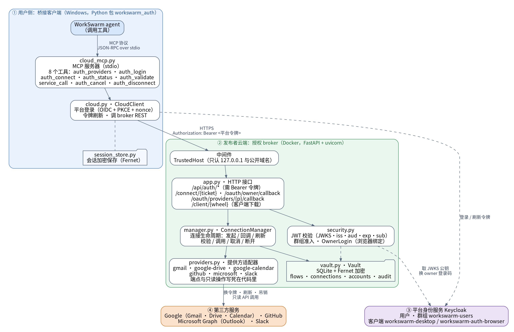

# WorkSwarm 统一授权 Connector v0.7.2

仅保留一条链路：**WorkSwarm → 云端授权服务 → 第三方 API**。
发布者在服务器配置第三方应用，普通用户不填写第三方 Client ID、Secret 或 token。
支持 Gmail、Google Drive、Google Calendar、GitHub、Microsoft（Outlook）、Slack，均为只读操作。

## 架构



| 组件 | 职责 |
|---|---|
| 服务端 `app / manager / providers / vault / security` | 第三方 OAuth、凭证加密、刷新/撤销、账号隔离、API 验证；强制 OIDC，不接受静态 API Key |
| 客户端 `cloud / cloud_commands / cloud_mcp / session_store` | 平台 OIDC 登录、浏览器跳转、授权等待/取消和 API 转发；仅缓存自己的平台会话，不建立凭证数据库 |
| 发布工具 `tools/` | 生成部署配置与不含服务端代码/秘密的 Windows 安装包、市场包 |

详细操作统一见 [CLOUD.md](CLOUD.md)；测试记录见 [VALIDATION.md](VALIDATION.md)。

## 用户如何使用

以下步骤面向普通用户，前提是发布者已完成部署并上架连接器。用户只需在 Windows 上安装 Python 3.11 或更高版本
（推荐 python.org 的 3.12 安装包，自带 `py` 启动器），不需要第三方 Client ID、Secret 或 token。

### 首次使用

1. **安装连接器**：在 WorkSwarm 连接器市场找到“第三方统一授权（云端托管）”并安装。
2. **点“连接”**：首次连接会自动下载并安装客户端，约需 20–60 秒，看到 8 个工具即完成。之后每次连接只需一两秒。
3. **新建会话**：在输入框旁的扩展面板中勾选本连接器。WorkSwarm 按会话加载连接器，没有勾选时 agent 看不到工具。
4. **提出需求**：例如“帮我连接 Gmail，然后看看最近一周的邮件”。
5. **登录平台**：浏览器会打开登录页。如果发布者已开启 Google 或 GitHub 登录，可直接用这些账号登录，首次登录自动开户。
6. **授权第三方服务**：在服务商的官方页面确认权限并同意，看到授权成功的提示后回到 WorkSwarm。
   整个过程请使用同一个浏览器，中途不要刷新页面。

每个服务只需授权一次，之后直接提问即可。

### 可以做什么

所有操作都是只读的。用自然语言提出需求即可，agent 会选择对应的操作。

| 服务 | 示例说法 | 可用操作 |
|---|---|---|
| Gmail | “帮我连接 Gmail，看看最近的邮件” | `gmail_search`、`gmail_read` |
| Google Drive | “列出我云端硬盘里的文件” | `drive_list` |
| Google Calendar | “列出我的日历” | `calendar_list` |
| GitHub | “列出我的 GitHub 仓库” | `github_profile`、`github_repos` |
| Microsoft（Outlook） | “看看我的 Outlook 邮件” | `microsoft_profile`、`outlook_list` |
| Slack | “查看我的 Slack 连接身份” | `slack_identity` |

### 管理连接

| 想做的事 | 对 agent 说 | 结果 |
|---|---|---|
| 查看连接状态 | “看看我连接了哪些服务” | 列出每个连接的状态；`authorization=authorized` 且 `validation=passed` 才算可用 |
| 重新登录平台 | “调用 auth_login 重新登录” | 打开平台登录页；已有连接不受影响，不需要重新授权 |
| 连接同一服务的另一个账号 | “用新的连接 ID 再连接一个 Gmail 账号” | 两个账号分别保存，互不影响 |
| 断开连接 | “断开我的 GitHub 连接” | 删除服务器上保存的凭证，并尝试在服务商处撤销授权 |

### 常见问题

| 现象 | 处理 |
|---|---|
| 连接立即失败，提示找不到 `py` | 安装 python.org 版 Python（包含 `py` 启动器），然后重启 WorkSwarm |
| 首次连接失败 | 多半是无法访问 PyPI 或发布者服务器；查看 WorkSwarm 日志中以 `[workswarm-auth]` 开头的行 |
| agent 说找不到工具 | 当前会话没有勾选本连接器 |
| `workswarm_login_required` | 平台会话已失效，调用 `auth_login` 重新登录 |
| `cloud_service_unavailable` | 连不上发布者服务器，检查网络后重试 |
| `operation_denied_by_policy` 或 `operation_not_allowed` | 操作名不对，不代表账号被禁止；改用错误信息里 `allowed_operations` 列出的操作 |
| `connection_link_expired_or_used` | 连接链接只能用一次，让 agent 重新发起连接 |
| `reauthorization_required` | 第三方授权已失效，让 agent 重新连接该服务 |

## 快速入口

发布者安装源码的服务端依赖：

```bash
python3 -m venv .venv
.venv/bin/python -m pip install -e '.[server,test]'
.venv/bin/python -m pytest -q
```

使用 `tools/publisher_setup.py` 准备真实 HTTPS 域名/身份系统，服务器上隐藏输入第三方应用凭证，
再运行 `tools/build_cloud_client.py` 生成用户发行包。源码包本身不含已部署服务地址。
把生成的客户端 wheel 放进 broker 数据目录的 `client/`，再把市场包上架。用户在市场安装并点击“连接”，
首次连接会自动下载安装客户端（只需本机有 Python 3.11+）。平台账号可用 Google/GitHub 登录并自动开户，
见 CLOUD.md 第 5a 节。不用市场时仍可解压 Windows 安装包运行 `Install-WorkSwarm-Auth.cmd`。
